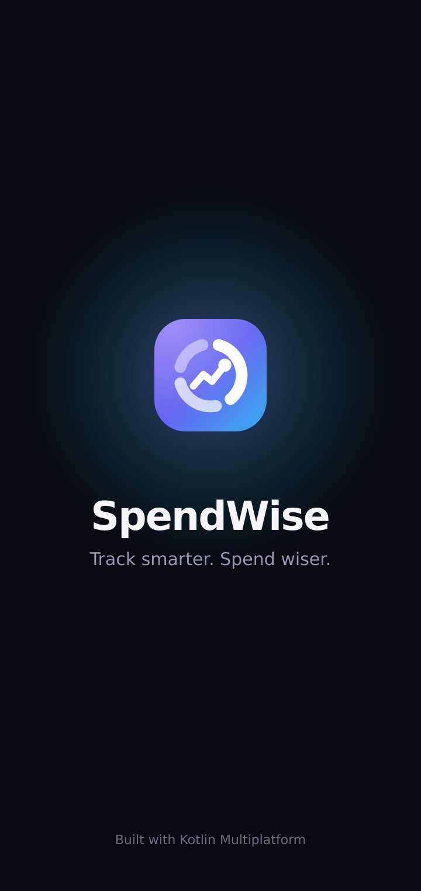
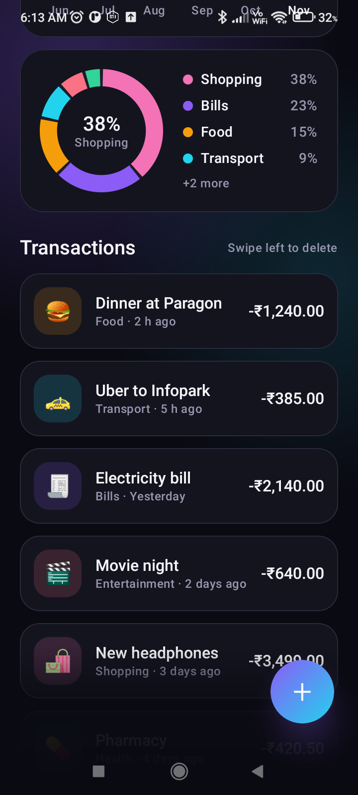
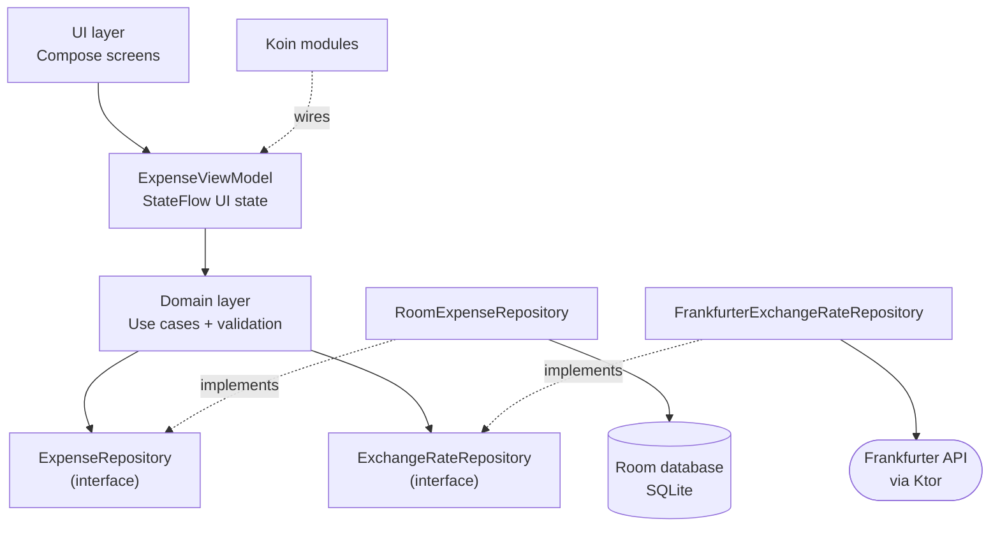

<div align="center">


# SpendWise

**Track smarter. Spend wiser.**

A modern expense tracker built with **Kotlin Multiplatform** and **Compose Multiplatform**.
Business logic *and* UI are shared between Android and iOS, on a Clean Architecture + MVVM foundation.


[](https://github.com/nijobenny/SpendWise/actions/workflows/ci.yml)

</div>

---

## 📱 Screenshots

| Splash | Monthly dashboard | Transactions | Add expense | Empty state |
|:---:|:---:|:---:|:---:|:---:|
|  |  |  |  |  |

## ✨ Features

### 💰 Spending insights
- **Monthly dashboard**: switch months with directional slide animations. The total counts up, with a **% change vs last month** pill.
- **6-month trend chart**: spring-animated bars. Tap any bar to jump to that month.
- **Category breakdown**: custom Canvas donut chart with a sweep-in animation and percentages.
- **Live currency conversion**: see each month's spending in **EUR, CHF, GBP and USD**, using ECB exchange rates from the Frankfurter API. Includes a loading shimmer, tap-to-retry and 1-hour caching.
- **Indian number formatting** (₹1,25,000.00) and compact chart labels (₹9.2k, ₹1.4L).

### ✍️ Managing expenses
- **Add expense**: large amount input, category chips and an optional note. Invalid input triggers a **shake animation** and an inline error banner.
- **Tap to edit** any transaction. The form is pre-filled and the original date is kept.
- **Swipe left to delete**, with a spring snap-back and **Undo** in the snackbar.
- **Offline-first**: everything is stored locally with Room and updates the UI reactively through `Flow`.

### 🎨 Premium look & feel
- **Animated splash**: the Android 12+ **SplashScreen API** (back-ported with core-splashscreen) hands over seamlessly to a Compose intro with a logo lift, breathing glow, light sweep and rising wordmark.
- **Adaptive app icon**: gradient background with a segmented-donut and trend mark, plus a **monochrome layer** for Android 13+ themed icons.
- **Dark design system**: gradient cards, ambient drifting glows, springy press feedback on every tap, and edge-to-edge layout.

## 🛠 Tech Stack

| Area | Technology |
|---|---|
| Language | Kotlin 2.4 |
| Cross-platform | Kotlin Multiplatform (Android + iOS) |
| UI | Compose Multiplatform, Material 3, custom Canvas drawing & animations |
| Architecture | Clean Architecture (domain / data / ui) + MVVM |
| Async | Kotlin Coroutines, `Flow`, `StateFlow`, `Channel` for one-off events |
| State | AndroidX Lifecycle ViewModel (KMP) |
| Database | Room 3 (KMP) with bundled SQLite driver, KSP code generation |
| Networking | Ktor client (OkHttp on Android, Darwin on iOS) + kotlinx.serialization |
| Dependency injection | Koin (separate data, domain and UI modules) |
| Date & time | kotlinx-datetime (time-zone aware month grouping) |
| Splash | AndroidX core-splashscreen + Compose intro animation |
| Testing | `kotlin.test` + `kotlinx-coroutines-test`, using fakes and a test dispatcher |
| CI | GitHub Actions: runs the tests and builds the APK on every push |
| Build | Gradle Kotlin DSL, version catalog |

## 🏗 Architecture



**Key design decisions**
- **Pure domain layer**: no Android, iOS or library types, so business rules are trivially unit-testable.
- **Money as `Long` minor units** (paise / cents), which avoids floating-point rounding errors.
- **Separate DB and API models**: `ExpenseEntity` and `RateDto` are mapped to domain models, so storage and network details never leak into the UI.
- **Injected clock and month function**: the monthly logic is a pure function, and tests don't depend on the device time zone.
- **State vs events**: screen state flows through `StateFlow`, and one-off events ("expense saved") through a `Channel`.
- **`expect` / `actual`** for platform specifics: database file location, current time and back handling.

```
shared/src/commonMain/kotlin/com/nijobenny/spendwise/
├── domain/
│   ├── model/          # Expense, Money, Category, MonthKey, ExchangeRates
│   ├── repository/     # ExpenseRepository, ExchangeRateRepository (interfaces)
│   └── usecase/        # Add, Update, Delete, Restore, Observe, MonthlyInsights, Validator
├── data/
│   ├── local/          # Room entity, DAO, database (+ expect/actual builders)
│   ├── remote/         # Ktor HTTP client, Frankfurter API, DTOs
│   └── repository/     # Room + exchange-rate repository implementations
├── ui/
│   ├── splash/         # Animated intro + logo drawn in code
│   ├── home/           # Dashboard, trend chart, currency card, transactions
│   ├── add/            # Add / edit expense screen
│   ├── components/     # Donut chart, gradient button, animated amount, bounce click
│   └── theme/          # Colors, typography, shapes, category styles
├── di/                 # Koin modules (data, domain, ui)
└── platform/           # expect/actual (time, back handling)
```

## ✅ Tests

- **ViewModel**: save, edit, validation errors, month navigation, delete and undo, rates loading and errors. Uses fake repositories and `UnconfinedTestDispatcher`.
- **Domain**: input validation, money parsing, category summaries, monthly insights, month arithmetic.
- **Data / UI helpers**: API → domain mapping, currency conversion rounding, currency and date formatting.

```bash
./gradlew :shared:allTests
```

All tests run automatically on every push via **GitHub Actions**, which also builds a debug APK (downloadable from the workflow run's artifacts).

## 🗺 Roadmap

- [x] Domain layer: models, use cases, validation and unit tests
- [x] Premium Compose UI with animations
- [x] Persistent storage with Room 3 (KMP) and bundled SQLite
- [x] Monthly filters and 6-month trend chart
- [x] GitHub Actions CI (tests and APK build on every push)
- [x] Dependency injection with Koin
- [x] Live currency conversion (Ktor + kotlinx.serialization)
- [x] Edit expenses + ViewModel unit tests
- [x] Premium adaptive app icon (with themed icon support)
- [x] Animated splash screen (SplashScreen API + Compose intro)
- [ ] Monthly budgets with alerts
- [ ] Home-screen widget

## 🚀 Run locally

1. Clone: `git clone https://github.com/nijobenny/SpendWise.git`
2. Open in **Android Studio** with the Kotlin Multiplatform plugin.
3. Run the **androidApp** configuration on a device or emulator.
4. Tap **Load sample data** to explore 6 months of example expenses.

## 👤 Author

**Nijo Benny**: Android Developer (Kotlin · Jetpack Compose · Kotlin Multiplatform)

[LinkedIn](https://linkedin.com/in/nijo-benny-81a5a6192) · [GitHub](https://github.com/nijobenny)
