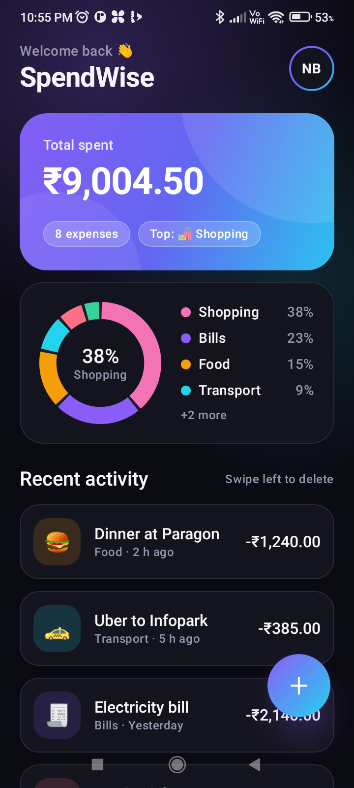
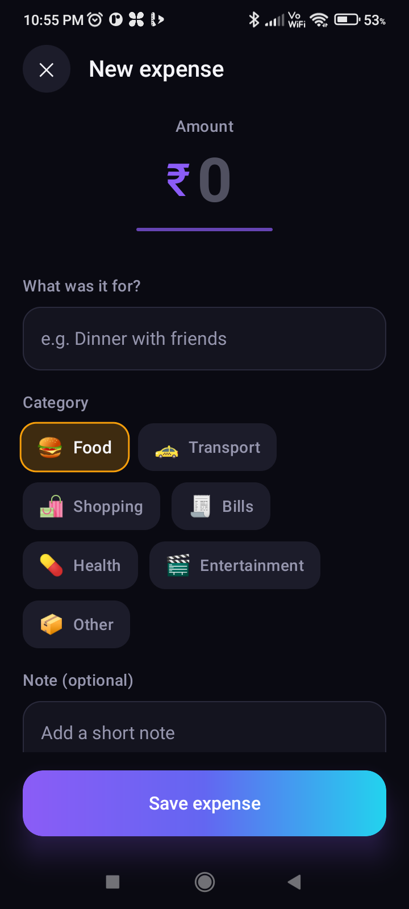
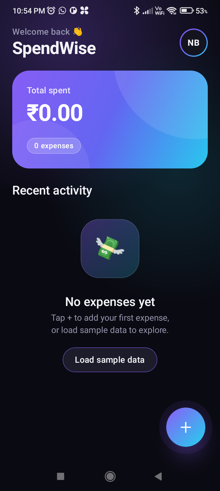
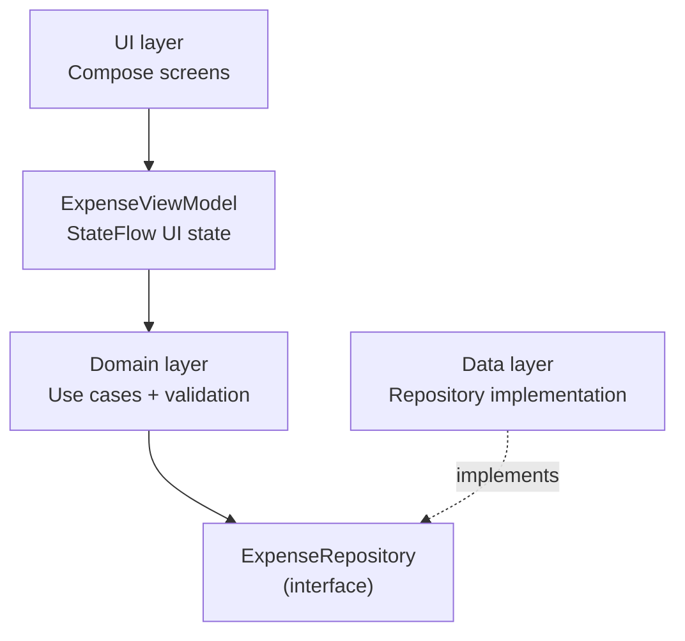

<div align="center">

# 💸 SpendWise

**A modern expense tracker built with Kotlin Multiplatform & Compose Multiplatform**

Shared business logic and UI for Android and iOS, built on Clean Architecture + MVVM.


🚧 *Work in progress: actively developed, one feature per commit.*

</div>

---

## 📱 Screenshots

| Home dashboard | Add expense | Empty state |
|:---:|:---:|:---:|
|  |  |  |

## ✨ Features

- **Spending dashboard**: animated total with count-up effect, Indian number formatting (₹1,25,000.00)
- **Category breakdown**: custom Canvas donut chart with sweep-in animation
- **Add expense flow**: validated form with shake animation and inline error banner on invalid input
- **Swipe to delete** with spring snap-back and **Undo** via snackbar
- **Premium dark UI**: gradient cards, ambient animated glows, springy press feedback on every tap
- **Shared code**: business logic *and* UI written once in `commonMain`, running on Android and iOS

## 🛠 Tech Stack

| Area | Technology |
|---|---|
| Language | Kotlin 2.4 |
| Cross-platform | Kotlin Multiplatform (Android + iOS) |
| UI | Compose Multiplatform, Material 3, custom Canvas drawing |
| Architecture | Clean Architecture (domain / data / ui) + MVVM |
| Async | Kotlin Coroutines, `Flow`, `StateFlow` |
| State | AndroidX Lifecycle ViewModel (KMP) |
| Testing | `kotlin.test` unit tests in `commonTest` |
| Build | Gradle (Kotlin DSL), version catalog |

## 🏗 Architecture



- **Domain** is pure Kotlin with no Android or iOS dependencies, so it's easy to test.
- **Money** is stored as `Long` minor units (paise / cents) to avoid floating-point rounding errors.
- **One-off events** (e.g. "expense saved") are sent through a `Channel`, and **screen state** through `StateFlow`.

```
shared/src/commonMain/kotlin/com/nijobenny/spendwise/
├── domain/
│   ├── model/          # Expense, Money, Category
│   ├── repository/     # ExpenseRepository interface
│   └── usecase/        # Add, Observe, Delete, Summary, Validator
├── data/
│   └── repository/     # Repository implementation
├── ui/
│   ├── home/           # Dashboard screen
│   ├── add/            # Add expense screen
│   ├── components/     # Donut chart, gradient button, animations
│   └── theme/          # Colors, typography, shapes
├── di/                 # Dependency wiring
└── platform/           # expect/actual (time, back handling)
```

## ✅ Tests

Unit tests cover input validation, money parsing, category summaries and currency formatting.

```bash
./gradlew :shared:allTests
```

## 🗺 Roadmap

- [x] Domain layer: models, use cases, validation + unit tests
- [x] Premium Compose UI with animations
- [ ] Persistent storage with Room (KMP)
- [ ] Dependency injection with Koin
- [ ] Monthly filters & spending trends chart
- [ ] Live currency conversion (Ktor)
- [ ] GitHub Actions CI

## 🚀 Run locally

1. Clone: `git clone https://github.com/nijobenny/SpendWise.git`
2. Open in **Android Studio** (with the Kotlin Multiplatform plugin)
3. Run the **androidApp** configuration on a device or emulator

## 👤 Author

**Nijo Benny**: Android Developer (Kotlin · Jetpack Compose · KMP)
[LinkedIn](https://linkedin.com/in/nijo-benny-81a5a6192) · [GitHub](https://github.com/nijobenny)
